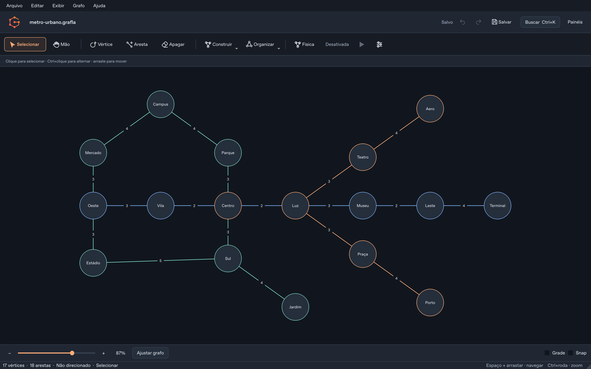
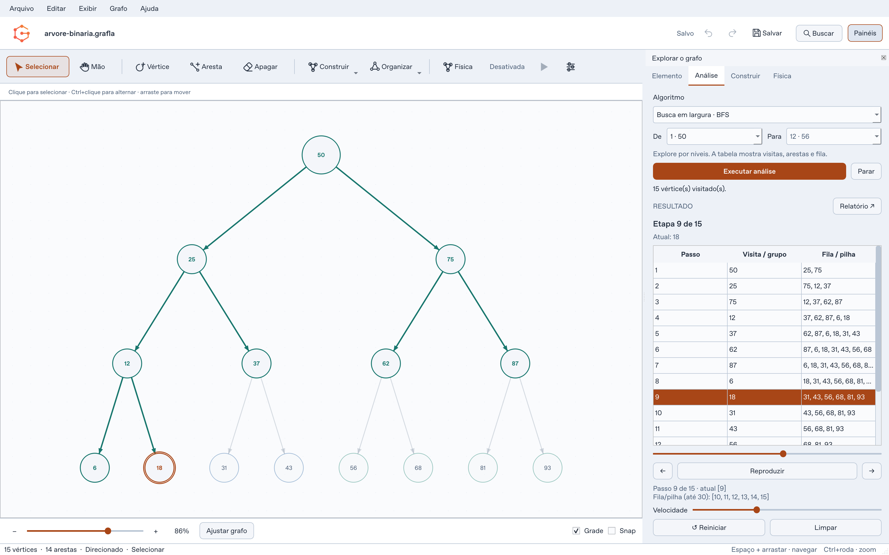
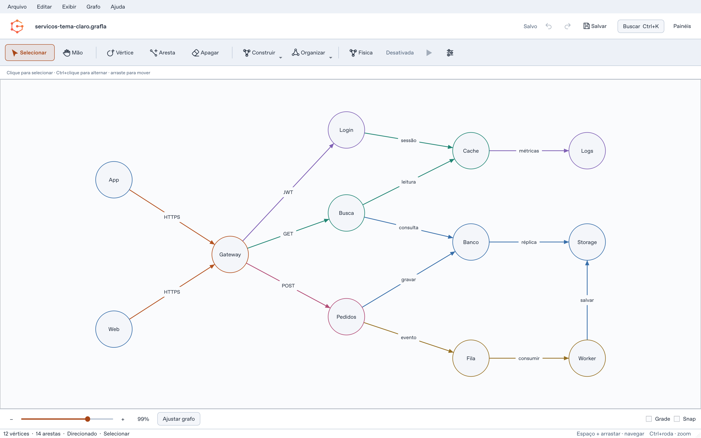
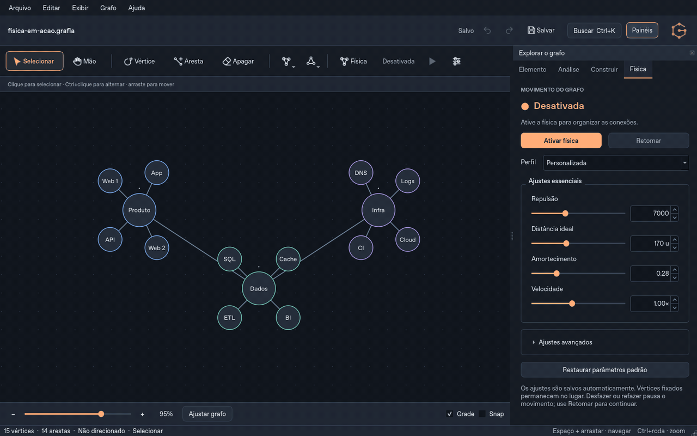

# Grafla

**Construir. Explorar. Compreender.**

O Grafla é um editor de grafos para desenhar conexões e acompanhar algoritmos em
ação. Dá para montar uma rede de rotas, organizar dependências ou estudar uma
busca passo a passo, vendo o que acontece no próprio grafo.

**[Baixar o Grafla 2.1.0 para Windows](https://github.com/ShardGem/Grafla/releases/download/2.1.0/Grafla-2.1.0-Windows-x64-Setup.exe)** ·
[Ver a galeria](docs/galeria.md) ·
[Novidades da versão](https://github.com/ShardGem/Grafla/releases/tag/2.1.0)



## Do desenho à análise

Crie os vértices, ligue as conexões e dê a cada um o nome e a cor que fizerem
sentido. As mudanças aparecem enquanto você edita. Quando estiver satisfeito,
aplique as propriedades; se mudar de ideia, reverta para os últimos valores
aplicados.

Com o grafo pronto, você pode:

- Encontrar caminhos com Dijkstra e acompanhar buscas em largura ou profundidade,
  pausando e avançando uma etapa por vez.
- Explorar componentes, árvores geradoras mínimas e ordenação topológica.
- Organizar os vértices com layouts ou deixar a física acomodar as conexões.
- Trabalhar com matrizes de adjacência e gerar grafos para experimentar.
- Salvar em `.grafla` para continuar depois ou exportar em PNG, JPG, SVG e PDF.

Também há seleção em grupo, copiar e colar, desfazer e refazer, além de temas claro
e escuro.

## Alguns exemplos

| Uma busca em árvore | Conexões entre serviços |
| --- | --- |
|  |  |

A [galeria](docs/galeria.md) tem mais exemplos: mapas de estudos, rotas de entrega,
dependências e outras formas de usar o editor. Os [grafos das imagens](examples/galeria/)
estão no repositório para você abrir e mexer.

## A física em movimento



Neste exemplo, três vértices ficam fixos enquanto os demais se acomodam. Você pode
pausar o movimento e ajustar a distância entre eles, a atração e a repulsão até
chegar à organização que preferir.

[Abrir esse grafo no editor](examples/fisica-em-acao.grafla)

## Para começar

No Windows, [baixe o instalador](https://github.com/ShardGem/Grafla/releases/download/2.1.0/Grafla-2.1.0-Windows-x64-Setup.exe),
abra o arquivo e siga a instalação. Depois, é só abrir o Grafla pelo menu Iniciar.
Não precisa instalar Python.

Se preferir rodar pelo código, use Python 3.12 a 3.15 e
[uv](https://docs.astral.sh/uv/). Na pasta do projeto:

```bash
uv sync --frozen
uv run grafla
```

Essa opção também permite usar o Grafla no Linux e no macOS, com ambiente gráfico.
Para gerar seu próprio instalador, há um [guia separado](docs/instalador.md).

---

O Grafla é feito com Python, PyQt6 e NetworkX.
[Arquitetura](docs/arquitetura.md) · [Histórico de mudanças](CHANGELOG.md) ·
[Avisos de terceiros](docs/terceiros.md)
