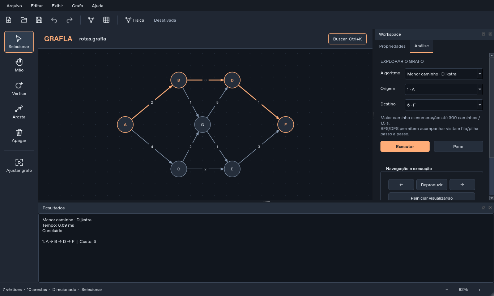

# Grafla

**Construir. Explorar. Compreender.**

Grafla 2.0 é um editor desktop de grafos em Python e Qt: edição direta, documentos
versionados, histórico de alterações, física opcional e análises com visualização.
O alvo principal é Windows; a base também pode ser executada em Linux e macOS.



## O que funciona

- Canvas com seleção individual/múltipla e por retângulo, movimento em grupo,
  conexões por dois cliques, laços, arestas opostas, exclusão e menus contextuais.
- Inspector de rótulo, posição, raio, cor, fixação, direção e peso. Arestas podem
  ser direcionadas ou não; pesos não negativos incluem zero.
- Desfazer/refazer de edição, exclusão com incidentes, geração, layouts, colagem,
  matrizes e organização pela física. Histórico limitado às últimas 60 operações.
- Novo, abrir, salvar, salvar como, recentes, indicação de alterações e confirmação
  de fechamento. Arquivos `.grafla` são JSON validado, com schema versionado e save atômico.
- Cópia de recuperação opcional a cada minuto, oferecida como novo documento após
  interrupção. Preferências e geometria são persistidas separadamente.
- **Física com controle próprio**, indicação de estado e pausa automática ao
  estabilizar ou atingir o orçamento de iterações. Desligar preserva as posições;
  reativar inicia a partir delas. Vértices fixados não são movidos.
- Dijkstra, maior caminho simples e enumeração com limites, BFS/DFS com visita,
  fila/pilha e arestas percorridas, componentes, floresta geradora mínima e topológica.
- Reprodução, pausa, passo anterior/seguinte, reinício e parada da visualização.
  Edições invalidam resultados antigos; tarefas usam um snapshot independente da UI.
- Matrizes binárias e de pesos, copiar CSV e construir grafo a partir de matriz.
  Layouts circular, grade e aleatório com operação desfazível.
- Exportação PNG/JPEG/SVG/PDF, região inteira ou seleção, largura configurável e
  transparência em PNG/SVG. A exportação exclui controles e handles do editor.
- Copiar/colar subgrafo, busca de comandos/vértices, zoom no cursor, navegação com
  Espaço/botão do meio, snap e temas Dark/Light/System.
- Splash ligada às etapas reais do bootstrap, sem pausa artificial, e controles
  **nativos de janela** para minimizar, maximizar/restaurar, arrastar e fechar.

## Executar

Requer Python **3.12–3.15** e uma sessão gráfica. A versão de referência validada
localmente é Python 3.12.14 com PyQt6/Qt 6.12.0.

Com [uv](https://docs.astral.sh/uv/):

```bash
uv sync --frozen
uv run grafla
uv run grafla examples/rotas.grafla
```

Ou com pip, em um ambiente virtual:

```bash
python -m pip install -e .
python -m grafla
```

`python main.py` continua disponível depois da instalação. `--no-splash` omite a
abertura; `--version` mostra a versão. Logs rotativos, preferências e recuperação
usam o diretório de dados do aplicativo do sistema. Para escolher outro:

```bash
uv run grafla --data-dir ./workspace-data
```

Adicione seu diretório de dados ao ignore local se o criar dentro do checkout.
Não versione preferências, logs ou documentos pessoais.

### Ambiente na nuvem / headless

O ambiente já é isolado: use o checkout existente, sem criar outro worktree.
Uma janela interativa exige desktop/servidor gráfico; o modo offscreen serve a
testes e não disponibiliza uma janela no navegador.

```bash
QT_QPA_PLATFORM=offscreen uv run grafla --smoke-test --data-dir /tmp/grafla-smoke
```

No cloud workspace, um diretório persistente gravável pode ser passado com
`--data-dir /workspace/.grafla-data`. O bootstrap de smoke gera uma captura e
encerra automaticamente, sem pedir confirmação de arquivo.

## Atalhos

| Ação | Atalho |
|---|---|
| Selecionar / mão / vértice / aresta / borracha | V / H / N / E / B |
| Pan temporário | Espaço + arrastar ou botão do meio |
| Multisseleção | Ctrl+clique ou retângulo no fundo |
| Apagar seleção | Delete |
| Cancelar conexão / limpar seleção | Esc |
| Desfazer / refazer | Ctrl+Z / Ctrl+Shift+Z ou Ctrl+Y |
| Novo / abrir / salvar / salvar como | Ctrl+N / Ctrl+O / Ctrl+S / Ctrl+Shift+S |
| Copiar / colar subgrafo | Ctrl+C / Ctrl+V |
| Buscar comandos e vértices | Ctrl+K ou Ctrl+F |
| Ajustar grafo / seleção / 100% | Ctrl+0 / F / Ctrl+1 |
| Zoom | Ctrl+roda ou Ctrl++ / Ctrl+- |
| Ativar/desativar física | Ctrl+Shift+P |
| Gerar grafo / exportar | Ctrl+G / Ctrl+Shift+E |

Atalhos de ferramentas pertencem ao canvas e não interceptam letras digitadas no
inspector. Os comandos também estão nos menus e na busca.

## Contratos e limites

- O grafo aceita direção por aresta e laços, mas **não arestas paralelas no mesmo
  sentido**. Uma conexão não direcionada impede outra ligação entre o mesmo par;
  duas direcionadas opostas são permitidas.
- Pesos aceitos: 0 a 1 bilhão, finitos. Sem ponderação, custo efetivo é 1. Rótulos:
  até 200 caracteres. IDs são estáveis e independem dos rótulos.
- Limites de documento: 10.000 vértices, 50.000 arestas e arquivo de até 32 MB.
  Esses limites de validação não são promessa de fluidez para qualquer densidade.
- Gerador: até 500 vértices/5.000 arestas e capacidade real do tipo escolhido.
  Seed reproduzível; a quantidade é exata e não usa tentativas que podem falhar silenciosamente.
- Física interativa: até 1.000 vértices/5.000 arestas, repulsão local aproximada,
  até 500 iterações por ativação. Grafos maiores continuam editáveis com layouts.
- Maior caminho e enumeração: até 300 caminhos encontrados / 1,5 segundo. O
  orçamento é verificado mesmo quando nenhum caminho é encontrado. Resultados
  interrompidos são parciais; o maior caminho parcial não é um ótimo comprovado.
- MST requer grafo não direcionado; topológica requer grafo dirigido acíclico.
  Componentes usa conectividade fraca; loops não duplicam a entrada de adjacência.
- Matriz de pesos: `·`/`.` é ausência; `0` é aresta de custo zero. A matriz não
  preserva posições, rótulos, estilos nem a direção individual de um grafo misto;
  use `.grafla` para roundtrip completo. Editor matricial: até 100 vértices;
  visualização: até 500. Trocar tipo/tamanho no diálogo reinicia a matriz pendente.
- Autosave é cópia de recuperação, **não** substitui Salvar nem marca o documento
  como salvo. Pode haver até um minuto de edição ainda não recuperável.
- Exportação: largura 128–4.096 e altura até 8.192; margem de 24 unidades da cena.
  SVG/PDF são vetoriais. JPEG não suporta transparência.

## Desenvolvimento e validação

```bash
uv sync --frozen --extra dev --extra build
uv run ruff check src tests tools main.py
uv run ruff format --check src tests tools main.py
uv run mypy
QT_QPA_PLATFORM=offscreen uv run pytest
QT_QPA_PLATFORM=offscreen uv run python tools/benchmark.py
```

No PowerShell, defina `$env:QT_QPA_PLATFORM = "offscreen"` antes dos testes headless.
A CI testa Linux/Windows, Python 3.12/3.14, e constrói o pacote Windows com smoke
test usando o backend nativo. Uma configuração de CI criada não equivale a uma
execução aprovada: consulte o resultado da execução no GitHub Actions.

Os testes cobrem invariantes, pesos/caminhos, serialização, arquivos inválidos,
undo/redo, cancelamento, recuperação, cliques/teclado, física, tema, resultados
obsoletos e arquivos gráficos reais. Mypy verifica os módulos matemáticos e de
persistência; Ruff verifica todo o código novo.

## Build desktop

```bash
uv sync --frozen --extra build
uv run pyinstaller --noconfirm packaging/grafla.spec
```

O resultado **onedir** fica em `dist/Grafla/`. Distribua a pasta completa. Construa
Windows em Windows; PyInstaller não faz cross-build de executável Windows em Linux.
O spec inclui recursos, metadados/licenças das dependências e versão obtida de
`grafla.__version__`. UPX fica desativado. Não há assinatura digital configurada.

Em Linux, uma execução gráfica normal também requer as bibliotecas nativas e um
servidor gráfico compatíveis com Qt. O smoke offscreen não valida o compositor do SO.

## Arquitetura e evolução

Veja [arquitetura](docs/arquitetura.md), [auditoria e decisões](docs/auditoria.md),
[design system](docs/design-system.md) e [changelog](CHANGELOG.md).

A modernização conserva o legado no commit `a9c310d`; módulos e assets obsoletos
foram retirados do caminho ativo após a substituição por componentes testados.
GraphML/GEXF/DOT, pesos negativos, minimap e algoritmos adicionais permanecem
possibilidades de evolução, sem controles fictícios na interface.

## Licenças

A licença do código do Grafla precisa ser definida pelo mantenedor antes de uma
distribuição pública que exija concessão explícita de direitos. Esta reformulação
não atribui uma licença nova ao código do autor.

PyQt6 é distribuído sob GPLv3 ou licença comercial; Qt tem termos por módulo e
NetworkX é BSD-3-Clause. Consulte [avisos de terceiros](docs/terceiros.md).
