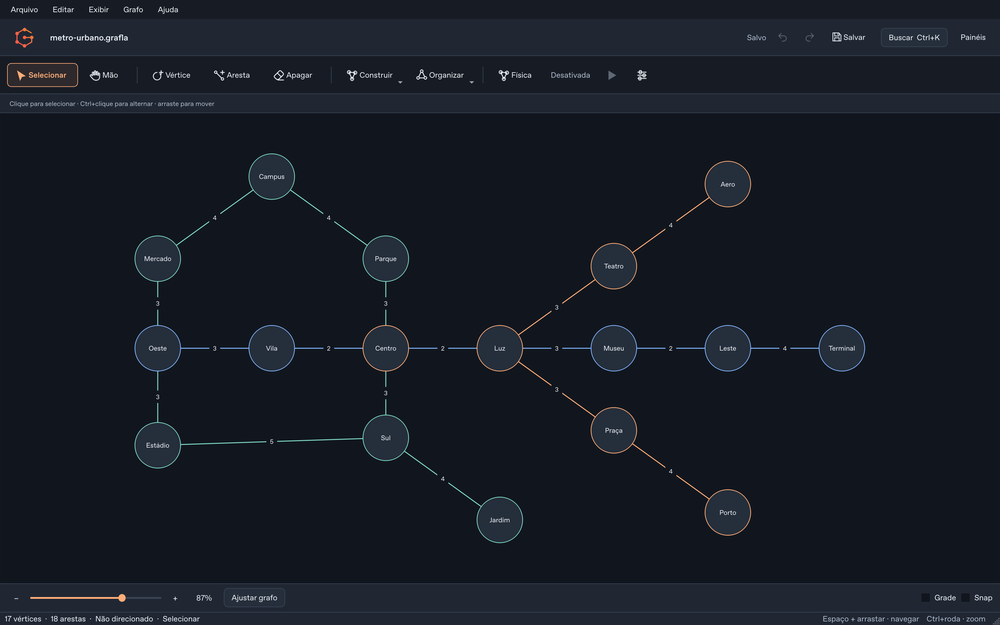
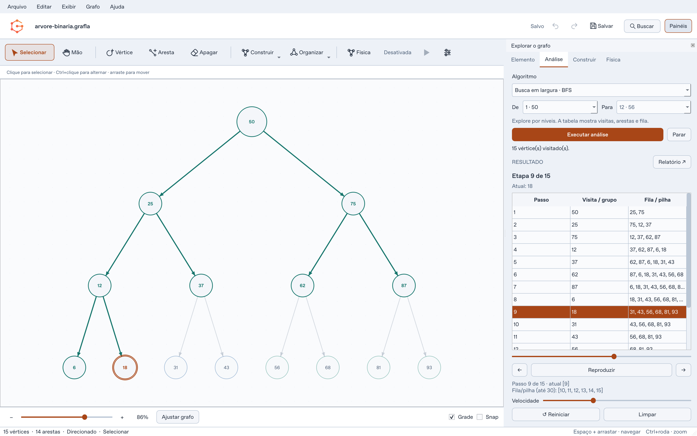
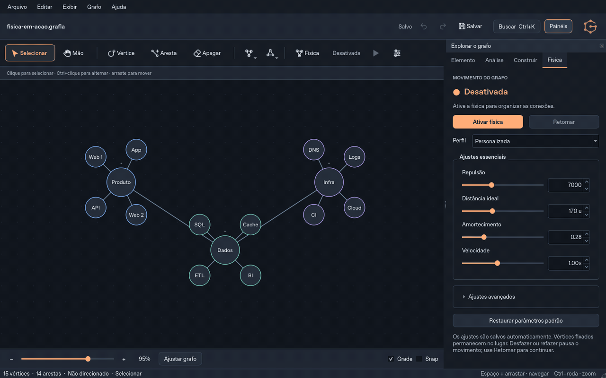
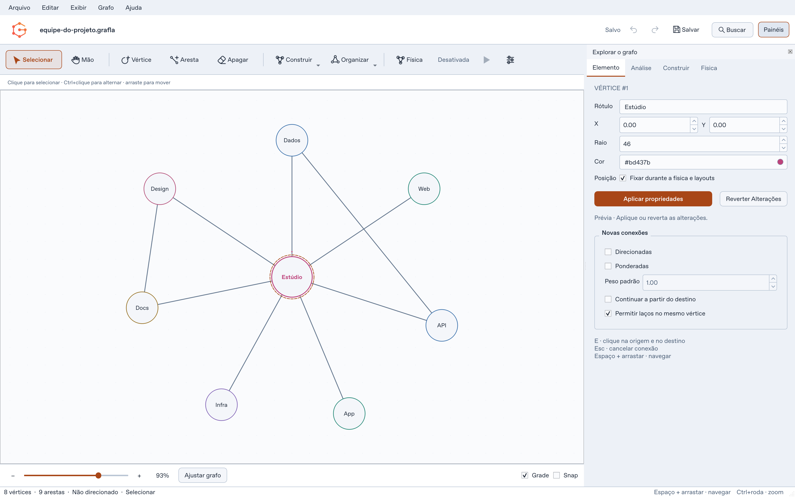
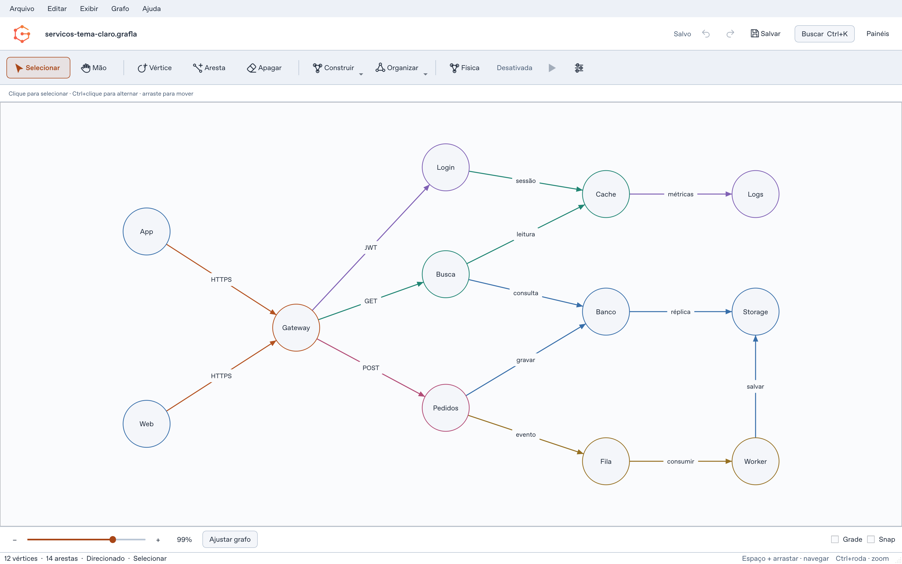
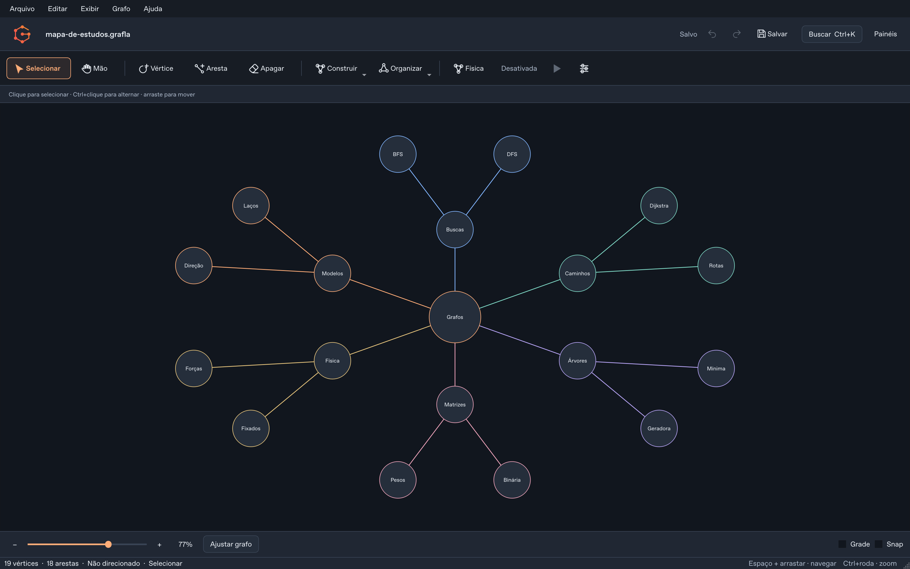

# GRAFLA 2.1.0 — primeira versão para baixar

> **Rascunho de lançamento:** publique este anúncio depois de disponibilizar o
> instalador da versão 2.1.0 na página de Releases.

**Construir. Explorar. Compreender.**

O GRAFLA chega à sua primeira versão pública para Windows. É um editor de grafos
para desenhar conexões, experimentar algoritmos e acompanhar os resultados no
próprio desenho. Dá para usar nos estudos, preparar exemplos para uma aula ou
organizar uma rede de ideias, rotas e dependências.

## O que dá para fazer

- Criar vértices e arestas diretamente no canvas, com conexões direcionadas,
  pesos, laços e ligações de ida e volta.
- Selecionar e mover vários elementos juntos, copiar trechos do grafo e
  desfazer ou refazer as edições.
- Editar rótulos, posição, tamanho e cores com prévia ao vivo. **Aplicar
  propriedades** confirma; **Reverter Alterações** volta aos últimos valores aplicados.
- Escolher as cores em uma roda de matiz e saturação, com ajuste de brilho.
- Gerar grafos e organizar os vértices em círculo, grade ou com a física.
- Converter grafos em matrizes e construir um grafo a partir de uma tabela.
- Salvar os projetos em `.grafla` e exportar o desenho em **PNG, JPEG, SVG e PDF**.
- Trabalhar com temas claro, escuro ou seguindo o sistema, além de zoom,
  grade, alinhamento e busca de comandos e vértices.

## Veja os algoritmos acontecendo

O editor reúne **Dijkstra, busca em largura (BFS), busca em profundidade (DFS),
componentes conexos, árvore geradora mínima e ordenação topológica**. Também
permite explorar caminhos simples e buscar o maior caminho, com limites de execução.

As buscas podem ser acompanhadas passo a passo. O vértice atual aparece no
desenho, enquanto a tabela mostra as visitas e a fila ou pilha. Nas rotas,
cada resultado traz o custo e a sequência dos vértices; selecionar outra opção
muda o destaque no grafo.

## Uma física que você pode ajustar

Ative a simulação para ver os vértices se acomodando. Dá para ajustar a repulsão,
a distância entre os pontos, o amortecimento e a velocidade, ou começar pelos
perfis **Equilibrada, Suave e Elástica**.

Você pode fixar os vértices que precisam ficar no lugar e pausar ou retomar o
movimento quando quiser. No exemplo abaixo, os três centros permanecem fixos
enquanto o restante da rede se organiza.

## Experimente antes de confirmar

Ao mudar o rótulo, a cor, o raio ou a posição, o resultado aparece no canvas
durante a edição. A prévia fica separada dos dados confirmados: você decide
se quer aplicar as mudanças ou reverter. Isso vale também para as propriedades
das arestas e para a edição de cores em grupo.

[Veja a roda de cores](https://raw.githubusercontent.com/ShardGem/Grafla/c9ada4ca8dc39722ee95e3698688ed65cbecd7fd/docs/screenshots/roda-de-cores.png).

## Vários jeitos de usar

Uma rede de metrô, uma árvore de busca, um mapa de estudos ou a arquitetura de
um sistema: os exemplos ajudam a explorar as ferramentas com grafos diferentes.
Os painéis podem ser recolhidos para dar mais espaço ao desenho.

A [galeria completa](https://github.com/ShardGem/Grafla/blob/c9ada4ca8dc39722ee95e3698688ed65cbecd7fd/docs/galeria.md)
tem **30 capturas** e **26 grafos de exemplo** para abrir no editor.

## Download e instalação

**Windows de 64 bits (x64).**

O instalador desta versão terá o nome **`Grafla-2.1.0-Windows-x64-Setup.exe`**.
Ele será disponibilizado na página de Releases:

**[Acessar os downloads do GRAFLA](https://github.com/ShardGem/Grafla/releases)**

Quando o arquivo estiver publicado:

1. Abra a release **Grafla 2.1.0** e procure a seção **Assets**.
2. Baixe o arquivo terminado em **`Setup.exe`**.
3. Execute o instalador e siga o assistente em português.
4. Abra o **Grafla** pelo menu Iniciar.

Não é necessário instalar Python para usar o aplicativo. O instalador inclui
o que ele precisa para funcionar, um desinstalador e a opção de criar um atalho
na área de trabalho.

---

Encontrou um problema ou tem uma sugestão?
[Abra uma issue no GitHub](https://github.com/ShardGem/Grafla/issues).
Se o projeto for útil para você, deixe uma estrela e compartilhe seus exemplos.

**[Repositório do GRAFLA](https://github.com/ShardGem/Grafla)**
