# Grafla em uso

30 capturas do aplicativo, com variações de tema, enquadramento e ferramentas. Metrô, arquitetura de serviços, estudos, árvores, matrizes e física: os exemplos são fictícios e podem ser abertos no editor.

As imagens foram capturadas no Qt em Linux offscreen, com uma janela de 1680×1050, escala de 200% e PNGs de 3360×2100. A captura dos ajustes avançados usa uma janela mais alta para mostrar o painel inteiro. A interface e os resultados são os do aplicativo, sem retoques. Clique em qualquer imagem para ver o tamanho completo.

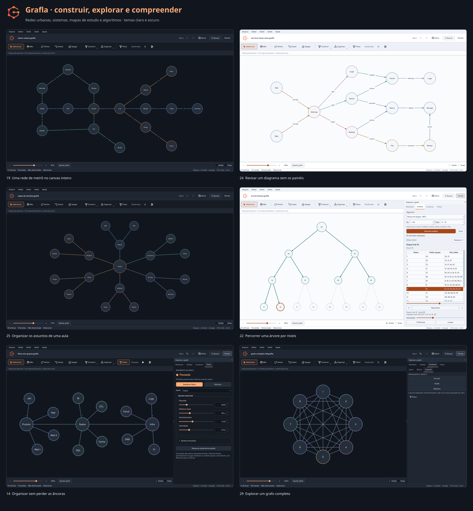

[Ver as 30 capturas em um painel](screenshots/galeria/00-visao-geral.png) · [Tema escuro](#caso-19) · [Tema claro](#caso-24) · [Canvas inteiro](#caso-25) · [Algoritmos](#caso-22) · [Layouts](#caso-28)

## Marca do Grafla

O símbolo aparece no canto superior esquerdo do editor e abre a tela Sobre. A abertura usa a marca horizontal enviada pelo autor, com o progresso das etapas de inicialização. As versões com o nome branco ficam sobre um fundo escuro nos dois temas, preservando as cores e o contraste.


[Carregando preferências](screenshots/splash-carregando.png) · [Editor pronto](screenshots/splash-pronta.png) · [Sobre no tema escuro](screenshots/sobre-dark.png) · [Sobre no tema claro](screenshots/sobre-light.png)

## Busca e preferências

A busca reúne comandos e vértices por nome ou ID. As preferências controlam tema, grade, snap, interação, recuperação e abertura.

[Busca de comandos](screenshots/busca-de-comandos.png) · [Preferências no tema escuro](screenshots/preferencias-dark.png) · [Preferências no tema claro](screenshots/preferencias-light.png)

## Propriedades e cores

Rótulo, cor, raio, posição e propriedades das arestas aparecem no canvas durante a edição. Aplicar confirma uma única operação de histórico; Reverter Alterações restaura os últimos valores aplicados. A roda de cores permite escolher matiz, saturação e brilho, com o hexadecimal disponível para quem precisar.

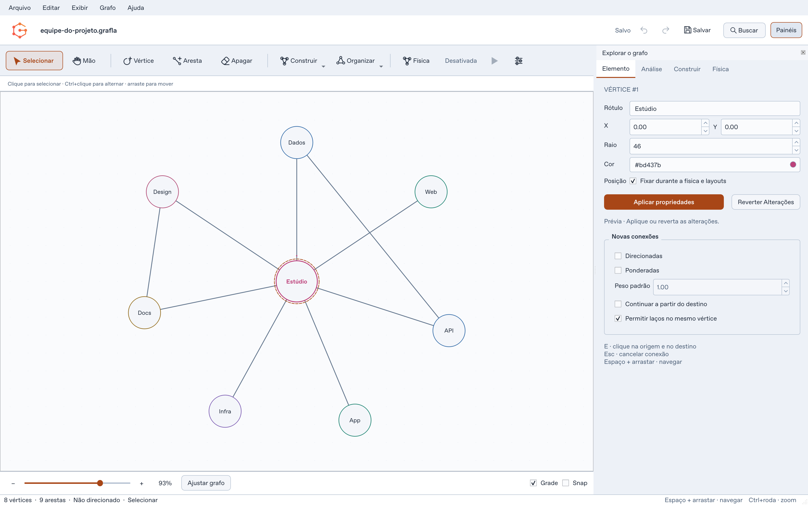

[Ver a roda de cores](screenshots/roda-de-cores.png)

## Física em movimento

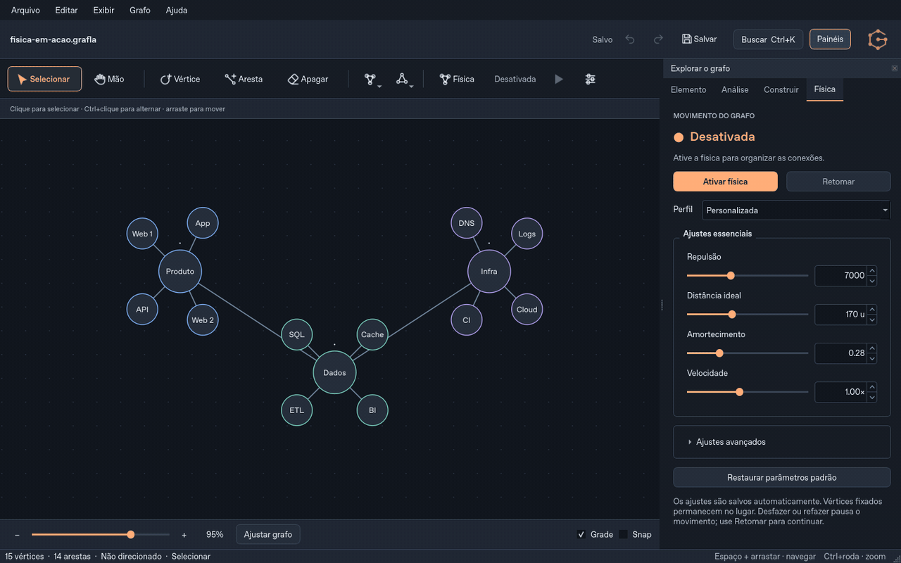

Os três centros permanecem fixos. A simulação acomoda os demais vértices, é pausada
e retoma com outra distância ideal. O GIF se repete a cada 12 segundos.

[Abrir o GIF](screenshots/fisica-em-acao.gif) ·
[Abrir o grafo inicial](../examples/fisica-em-acao.grafla)

## Escolha um exemplo

| Captura | O que mostra |
| --- | --- |
| [01 · Planejar uma entrega](#caso-01) | Dijkstra encontra o menor custo entre o centro de distribuição e o destino. |
| [02 · Comparar alternativas](#caso-02) | A lista de rotas mostra custos e sequências; clicar em outra opção muda o destaque. |
| [03 · Busca em largura](#caso-03) | BFS percorre a rede por níveis. A tabela mostra a ordem das visitas e a fila. |
| [04 · Busca em profundidade](#caso-04) | A mesma rede percorrida em profundidade, com a pilha e o passo atual visíveis. |
| [05 · Conectar com menor custo](#caso-05) | Uma rede de fibra com nove pontos. A árvore mínima destaca as conexões escolhidas. |
| [06 · Organizar dependências](#caso-06) | Um projeto da primeira tarefa à publicação, com a ordenação topológica em etapas. |
| [07 · Encontrar grupos separados](#caso-07) | Quatro componentes, incluindo um vértice isolado. Um dos grupos está em destaque. |
| [08 · Cuidar dos detalhes](#caso-08) | Rótulo, posição, raio, cor e fixação do vértice central no inspector. |
| [09 · Construir novas conexões](#caso-09) | Origem marcada, prévia da aresta e novas conexões direcionadas, com peso e sequência. |
| [10 · Desenhar um fluxo de estados](#caso-10) | Um pedido pode aguardar, avançar, voltar ou falhar. Laços e arestas opostas coexistem. |
| [11 · Ler o grafo como matriz](#caso-11) | Arestas e pesos na tabela. O zero é uma conexão real; o ponto marca uma ausência. |
| [12 · Construir a partir de uma tabela](#caso-12) | A matriz vira um grafo editável, organizado para leitura. O peso zero também é preservado. |
| [13 · Começar com uma rede pronta](#caso-13) | O gerador criou 18 vértices e 24 arestas. A seed permite repetir o mesmo exemplo. |
| [14 · Organizar sem perder as âncoras](#caso-14) | Três centros fixados mantêm a estrutura; os demais vértices foram organizados pela física. |
| [15 · Ajustar as forças em tempo real](#caso-15) | Gravidade, direção, rigidez, centralização e limites de movimento nos ajustes avançados. |
| [16 · O mesmo trabalho no tema claro](#caso-16) | A rota de menor custo no tema claro, preservando os destaques e o contraste dos controles. |
| [17 · Editar uma seleção inteira](#caso-17) | Pessoas e projetos numa rede bipartida, com três elementos selecionados para edição em grupo. |
| [18 · Trocar o enquadramento da rede](#caso-18) | A rede do gerador reorganizada em círculo pelo painel de layouts, sem mudar as conexões. |
| [19 · Uma rede de metrô no canvas inteiro](#caso-19) | Dezessete estações e três linhas coloridas, com tempos por trecho. Painéis recolhidos e grade desligada deixam o mapa em primeiro plano. |
| [20 · Do campus ao porto](#caso-20) | Dijkstra encontra a viagem de menor custo entre Campus e Porto. O mesmo metrô aparece no tema claro, com as cores ajustadas para esse fundo. |
| [21 · Planejar uma trilha de estudos](#caso-21) | Doze disciplinas e seus pré-requisitos. A ordenação topológica mostra uma sequência possível, com a etapa atual em destaque. |
| [22 · Percorrer uma árvore por níveis](#caso-22) | Uma árvore binária com quinze valores. A busca em largura mostra as visitas, o vértice atual e a fila ao lado do desenho. |
| [23 · Desenhar as conexões de um sistema](#caso-23) | Clientes, gateway, serviços, banco e fila. Os rótulos descrevem as chamadas; uma conexão está selecionada para edição no inspector. |
| [24 · Revisar um diagrama sem os painéis](#caso-24) | A arquitetura no tema claro, com mais espaço no canvas. Direções, protocolos e cores ajudam a acompanhar o fluxo entre os serviços. |
| [25 · Organizar os assuntos de uma aula](#caso-25) | Um mapa com dezenove vértices e seis assuntos. Cores e tamanhos foram editados no grafo para separar os ramos do estudo. |
| [26 · Editar um ramo em conjunto](#caso-26) | Três vértices do ramo Caminhos selecionados no tema claro. O inspector apresenta as propriedades da seleção em grupo. |
| [27 · Consultar e copiar as rotas](#caso-27) | Caminhos alternativos no metrô, com o relatório textual aberto abaixo do canvas e a lista navegável de rotas ao lado. |
| [28 · Organizar uma malha em grade](#caso-28) | Vinte e cinco vértices e quarenta conexões, organizados pelo layout em grade. O snap está ligado para os próximos movimentos. |
| [29 · Explorar um grafo completo](#caso-29) | K8 tem oito vértices e vinte e oito arestas. O layout circular separa os vértices e evidencia todas as conexões entre eles. |
| [30 · Combinar custos decimais e custo zero](#caso-30) | Um circuito cultural com pesos fracionários e uma conexão de custo zero. A rota até o Café mantém esses valores no cálculo de Dijkstra. |

## Capturas

<a id="caso-01"></a>

### 01 · Planejar uma entrega

Dijkstra encontra o menor custo entre o centro de distribuição e o destino.

[Abrir o grafo de exemplo](../examples/galeria/rotas-de-entrega.grafla) · [Ver a imagem completa](screenshots/galeria/01-rotas-de-entrega.png)

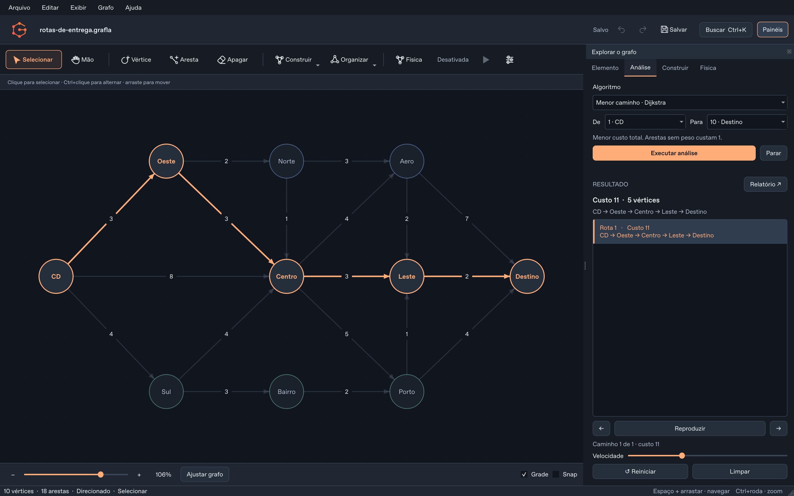

<a id="caso-02"></a>

### 02 · Comparar alternativas

A lista de rotas mostra custos e sequências; clicar em outra opção muda o destaque.

[Abrir o grafo de exemplo](../examples/galeria/rotas-de-entrega.grafla) · [Ver a imagem completa](screenshots/galeria/02-comparar-caminhos.png)


<a id="caso-03"></a>

### 03 · Busca em largura

BFS percorre a rede por níveis. A tabela mostra a ordem das visitas e a fila.

[Abrir o grafo de exemplo](../examples/galeria/buscas-em-rede.grafla) · [Ver a imagem completa](screenshots/galeria/03-busca-em-largura.png)


<a id="caso-04"></a>

### 04 · Busca em profundidade

A mesma rede percorrida em profundidade, com a pilha e o passo atual visíveis.

[Abrir o grafo de exemplo](../examples/galeria/buscas-em-rede.grafla) · [Ver a imagem completa](screenshots/galeria/04-busca-em-profundidade.png)


<a id="caso-05"></a>

### 05 · Conectar com menor custo

Uma rede de fibra com nove pontos. A árvore mínima destaca as conexões escolhidas.

[Abrir o grafo de exemplo](../examples/galeria/rede-de-fibra.grafla) · [Ver a imagem completa](screenshots/galeria/05-arvore-geradora-minima.png)

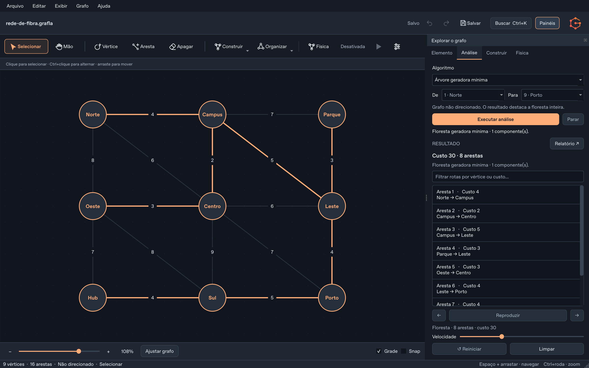

<a id="caso-06"></a>

### 06 · Organizar dependências

Um projeto da primeira tarefa à publicação, com a ordenação topológica em etapas.

[Abrir o grafo de exemplo](../examples/galeria/dependencias-do-projeto.grafla) · [Ver a imagem completa](screenshots/galeria/06-dependencias.png)

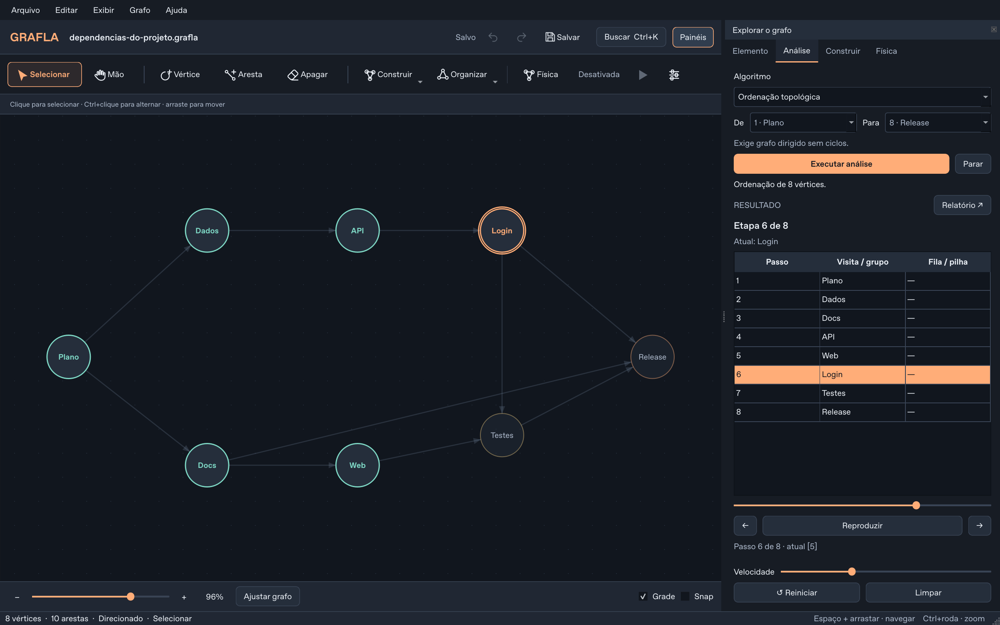

<a id="caso-07"></a>

### 07 · Encontrar grupos separados

Quatro componentes, incluindo um vértice isolado. Um dos grupos está em destaque.

[Abrir o grafo de exemplo](../examples/galeria/comunidades.grafla) · [Ver a imagem completa](screenshots/galeria/07-componentes.png)


<a id="caso-08"></a>

### 08 · Cuidar dos detalhes

Rótulo, posição, raio, cor e fixação do vértice central no inspector.

[Abrir o grafo de exemplo](../examples/galeria/equipe-do-projeto.grafla) · [Ver a imagem completa](screenshots/galeria/08-propriedades.png)


<a id="caso-09"></a>

### 09 · Construir novas conexões

Origem marcada, prévia da aresta e novas conexões direcionadas, com peso e sequência.

[Abrir o grafo de exemplo](../examples/galeria/equipe-do-projeto.grafla) · [Ver a imagem completa](screenshots/galeria/09-criar-conexoes.png)


<a id="caso-10"></a>

### 10 · Desenhar um fluxo de estados

Um pedido pode aguardar, avançar, voltar ou falhar. Laços e arestas opostas coexistem.

[Abrir o grafo de exemplo](../examples/galeria/fluxo-de-pedidos.grafla) · [Ver a imagem completa](screenshots/galeria/10-lacos-e-opostas.png)


<a id="caso-11"></a>

### 11 · Ler o grafo como matriz

Arestas e pesos na tabela. O zero é uma conexão real; o ponto marca uma ausência.

[Abrir o grafo de exemplo](../examples/galeria/matriz-de-pesos.grafla) · [Ver a imagem completa](screenshots/galeria/11-grafo-para-matriz.png)


<a id="caso-12"></a>

### 12 · Construir a partir de uma tabela

A matriz vira um grafo editável, organizado para leitura. O peso zero também é preservado.

[Abrir o grafo de exemplo](../examples/galeria/grafo-da-matriz.grafla) · [Ver a imagem completa](screenshots/galeria/12-matriz-para-grafo.png)

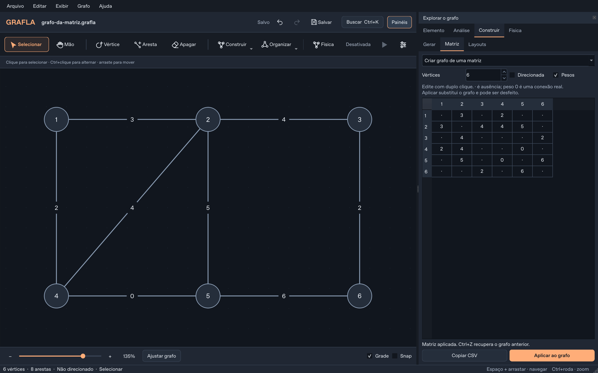

<a id="caso-13"></a>

### 13 · Começar com uma rede pronta

O gerador criou 18 vértices e 24 arestas. A seed permite repetir o mesmo exemplo.

[Abrir o grafo de exemplo](../examples/galeria/rede-gerada.grafla) · [Ver a imagem completa](screenshots/galeria/13-gerador.png)


<a id="caso-14"></a>

### 14 · Organizar sem perder as âncoras

Três centros fixados mantêm a estrutura; os demais vértices foram organizados pela física.

[Abrir o grafo de exemplo](../examples/galeria/fisica-em-grupos.grafla) · [Ver a imagem completa](screenshots/galeria/14-fisica.png)


<a id="caso-15"></a>

### 15 · Ajustar as forças em tempo real

Gravidade, direção, rigidez, centralização e limites de movimento nos ajustes avançados.

[Abrir o grafo de exemplo](../examples/galeria/fisica-com-gravidade.grafla) · [Ver a imagem completa](screenshots/galeria/15-fisica-avancada.png)

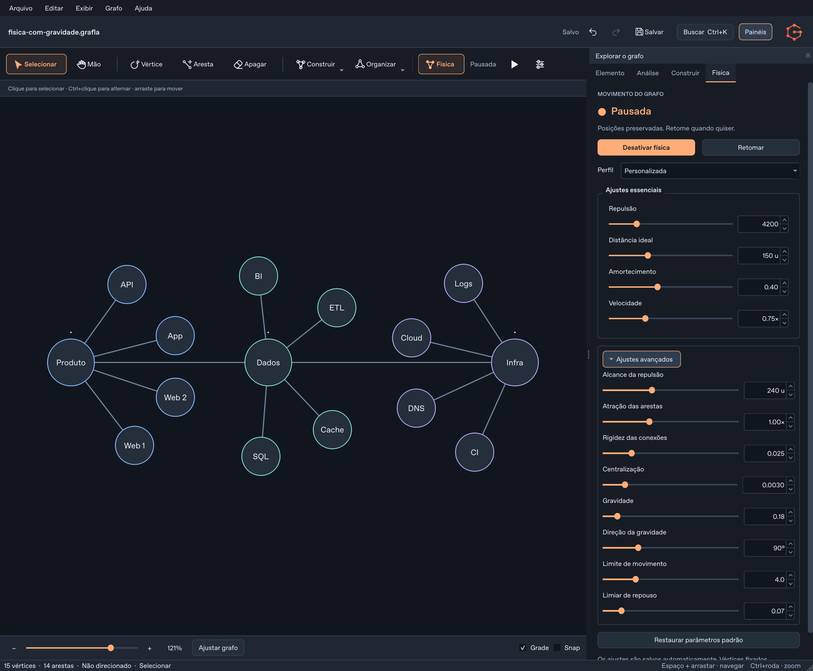

<a id="caso-16"></a>

### 16 · O mesmo trabalho no tema claro

A rota de menor custo no tema claro, preservando os destaques e o contraste dos controles.

[Abrir o grafo de exemplo](../examples/galeria/rotas-tema-claro.grafla) · [Ver a imagem completa](screenshots/galeria/16-tema-claro.png)


<a id="caso-17"></a>

### 17 · Editar uma seleção inteira

Pessoas e projetos numa rede bipartida, com três elementos selecionados para edição em grupo.

[Abrir o grafo de exemplo](../examples/galeria/pessoas-e-projetos.grafla) · [Ver a imagem completa](screenshots/galeria/17-selecao-em-grupo.png)


<a id="caso-18"></a>

### 18 · Trocar o enquadramento da rede

A rede do gerador reorganizada em círculo pelo painel de layouts, sem mudar as conexões.

[Abrir o grafo de exemplo](../examples/galeria/rede-circular.grafla) · [Ver a imagem completa](screenshots/galeria/18-layout-circular.png)


<a id="caso-19"></a>

### 19 · Uma rede de metrô no canvas inteiro

Dezessete estações e três linhas coloridas, com tempos por trecho. Painéis recolhidos e grade desligada deixam o mapa em primeiro plano.

[Abrir o grafo de exemplo](../examples/galeria/metro-urbano.grafla) · [Ver a imagem completa](screenshots/galeria/19-rede-de-metro.png)

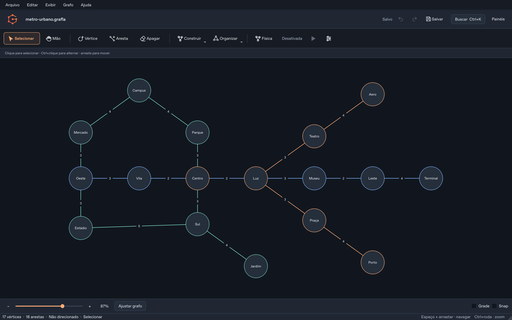

<a id="caso-20"></a>

### 20 · Do campus ao porto

Dijkstra encontra a viagem de menor custo entre Campus e Porto. O mesmo metrô aparece no tema claro, com as cores ajustadas para esse fundo.

[Abrir o grafo de exemplo](../examples/galeria/metro-tema-claro.grafla) · [Ver a imagem completa](screenshots/galeria/20-metro-tema-claro.png)

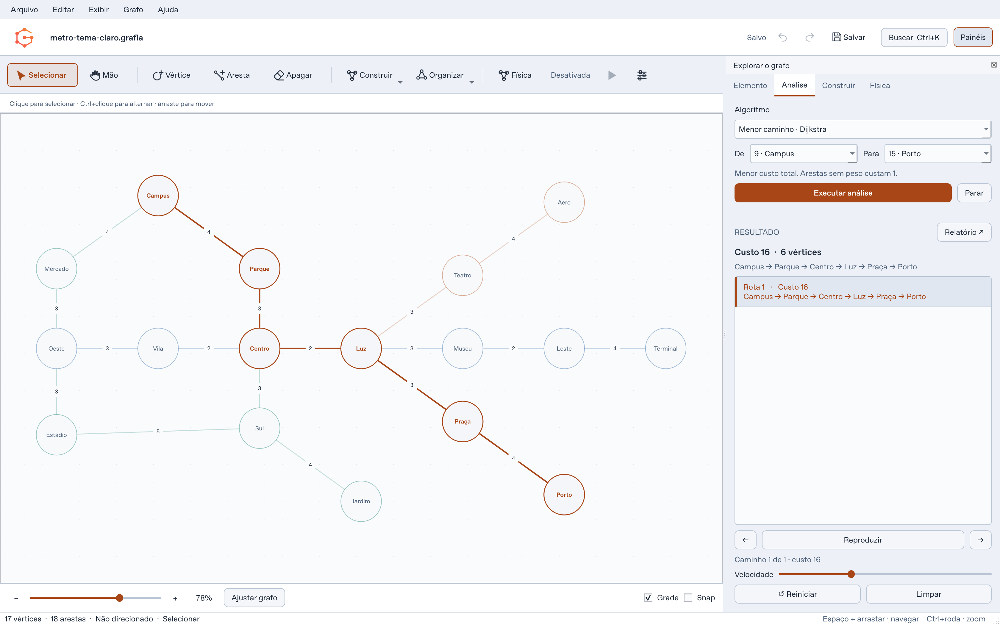

<a id="caso-21"></a>

### 21 · Planejar uma trilha de estudos

Doze disciplinas e seus pré-requisitos. A ordenação topológica mostra uma sequência possível, com a etapa atual em destaque.

[Abrir o grafo de exemplo](../examples/galeria/pre-requisitos.grafla) · [Ver a imagem completa](screenshots/galeria/21-pre-requisitos.png)

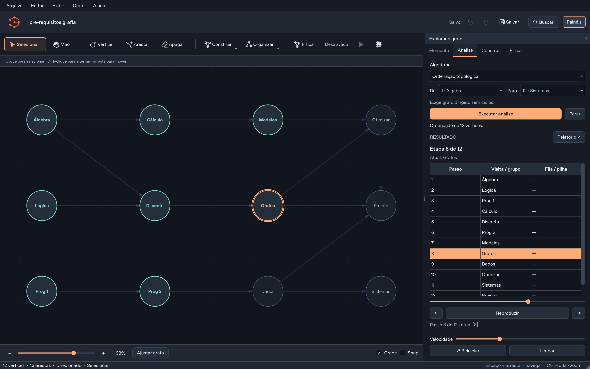

<a id="caso-22"></a>

### 22 · Percorrer uma árvore por níveis

Uma árvore binária com quinze valores. A busca em largura mostra as visitas, o vértice atual e a fila ao lado do desenho.

[Abrir o grafo de exemplo](../examples/galeria/arvore-binaria.grafla) · [Ver a imagem completa](screenshots/galeria/22-arvore-binaria.png)

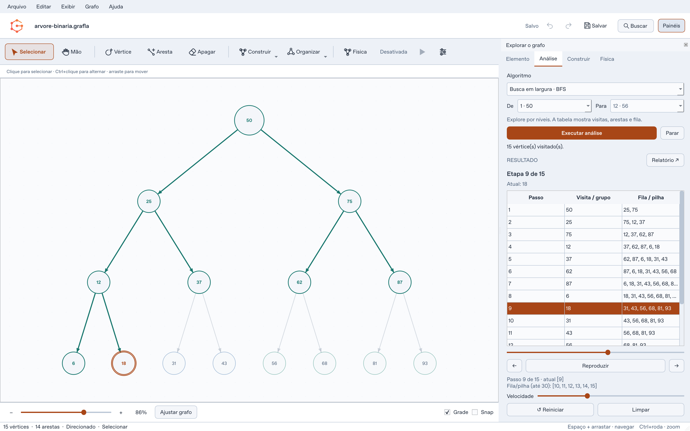

<a id="caso-23"></a>

### 23 · Desenhar as conexões de um sistema

Clientes, gateway, serviços, banco e fila. Os rótulos descrevem as chamadas; uma conexão está selecionada para edição no inspector.

[Abrir o grafo de exemplo](../examples/galeria/arquitetura-de-servicos.grafla) · [Ver a imagem completa](screenshots/galeria/23-arquitetura-de-servicos.png)

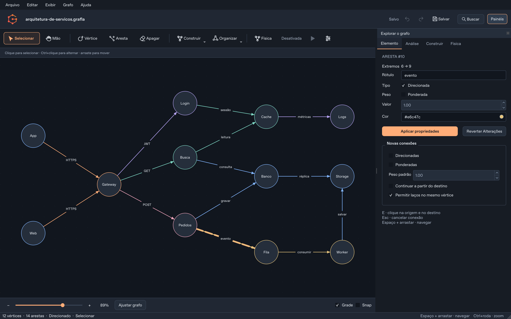

<a id="caso-24"></a>

### 24 · Revisar um diagrama sem os painéis

A arquitetura no tema claro, com mais espaço no canvas. Direções, protocolos e cores ajudam a acompanhar o fluxo entre os serviços.

[Abrir o grafo de exemplo](../examples/galeria/servicos-tema-claro.grafla) · [Ver a imagem completa](screenshots/galeria/24-servicos-tema-claro.png)

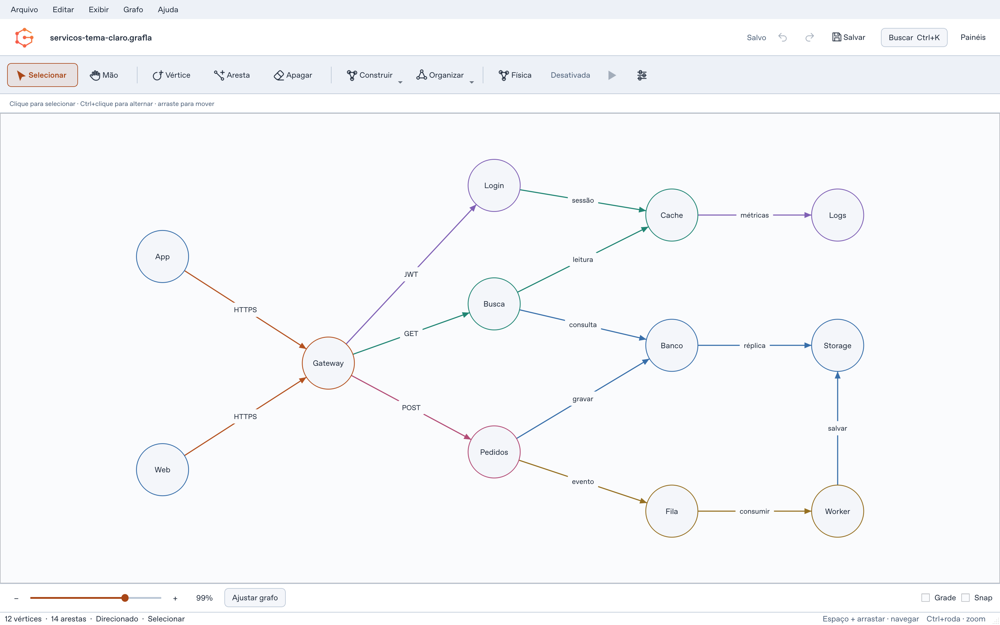

<a id="caso-25"></a>

### 25 · Organizar os assuntos de uma aula

Um mapa com dezenove vértices e seis assuntos. Cores e tamanhos foram editados no grafo para separar os ramos do estudo.

[Abrir o grafo de exemplo](../examples/galeria/mapa-de-estudos.grafla) · [Ver a imagem completa](screenshots/galeria/25-mapa-de-estudos.png)

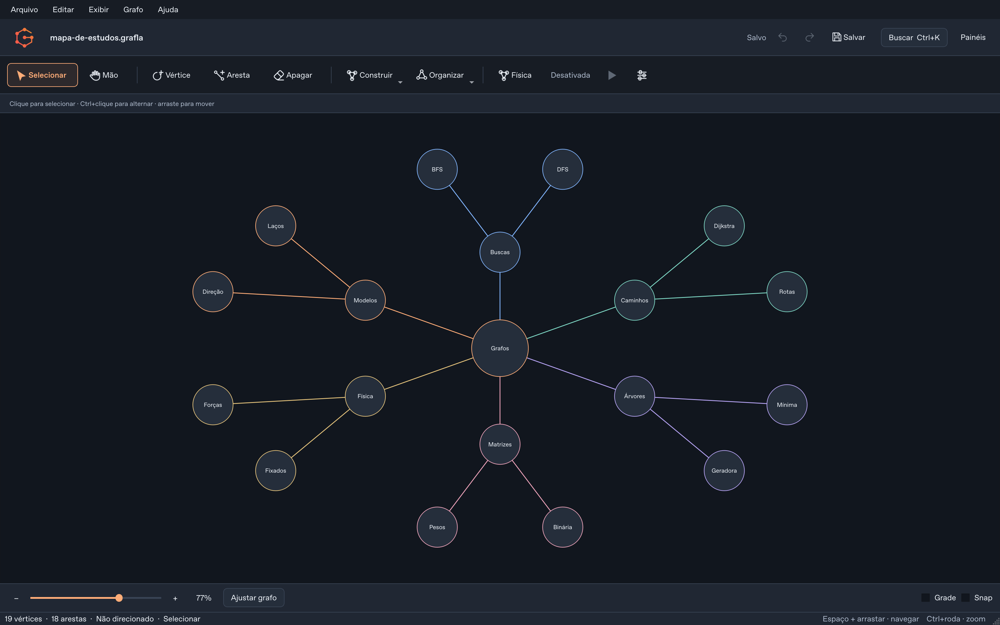

<a id="caso-26"></a>

### 26 · Editar um ramo em conjunto

Três vértices do ramo Caminhos selecionados no tema claro. O inspector apresenta as propriedades da seleção em grupo.

[Abrir o grafo de exemplo](../examples/galeria/mapa-tema-claro.grafla) · [Ver a imagem completa](screenshots/galeria/26-selecao-no-mapa.png)

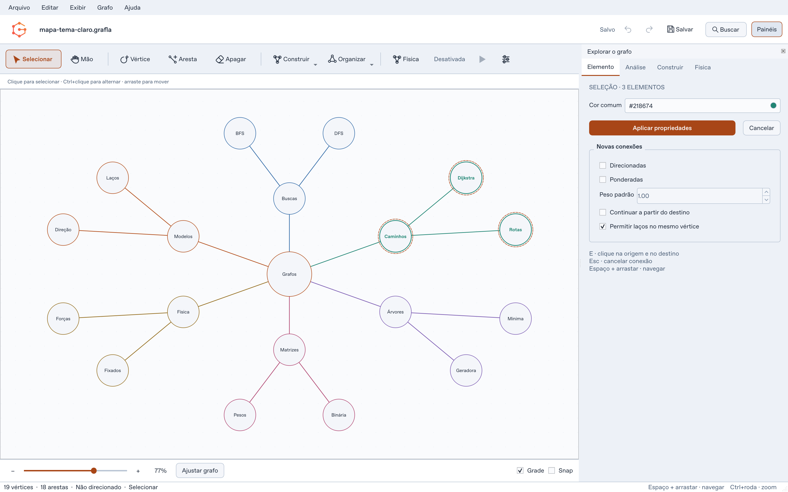

<a id="caso-27"></a>

### 27 · Consultar e copiar as rotas

Caminhos alternativos no metrô, com o relatório textual aberto abaixo do canvas e a lista navegável de rotas ao lado.

[Abrir o grafo de exemplo](../examples/galeria/metro-urbano.grafla) · [Ver a imagem completa](screenshots/galeria/27-relatorio-de-rotas.png)

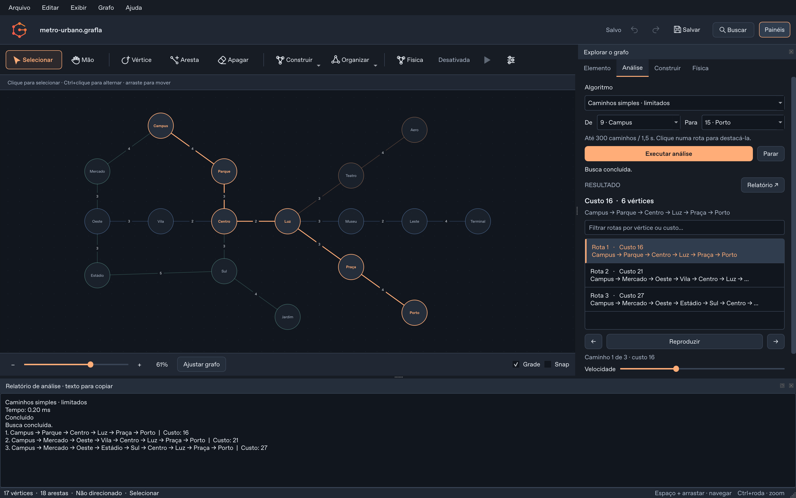

<a id="caso-28"></a>

### 28 · Organizar uma malha em grade

Vinte e cinco vértices e quarenta conexões, organizados pelo layout em grade. O snap está ligado para os próximos movimentos.

[Abrir o grafo de exemplo](../examples/galeria/malha-de-rede.grafla) · [Ver a imagem completa](screenshots/galeria/28-layout-em-grade.png)

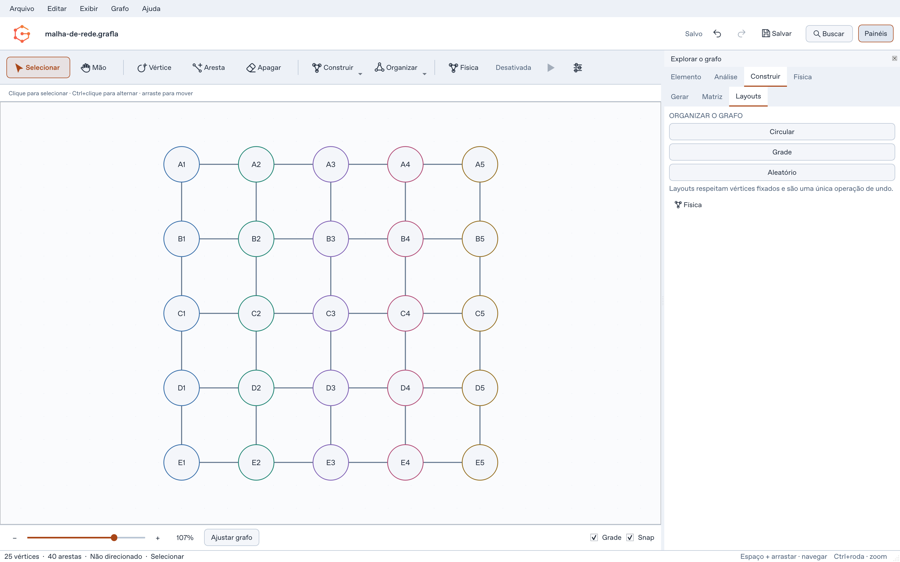

<a id="caso-29"></a>

### 29 · Explorar um grafo completo

K8 tem oito vértices e vinte e oito arestas. O layout circular separa os vértices e evidencia todas as conexões entre eles.

[Abrir o grafo de exemplo](../examples/galeria/grafo-completo-k8.grafla) · [Ver a imagem completa](screenshots/galeria/29-grafo-completo.png)

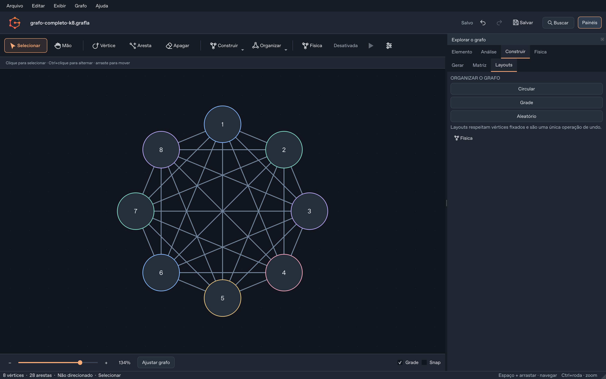

<a id="caso-30"></a>

### 30 · Combinar custos decimais e custo zero

Um circuito cultural com pesos fracionários e uma conexão de custo zero. A rota até o Café mantém esses valores no cálculo de Dijkstra.

[Abrir o grafo de exemplo](../examples/galeria/circuito-cultural.grafla) · [Ver a imagem completa](screenshots/galeria/30-pesos-decimais.png)

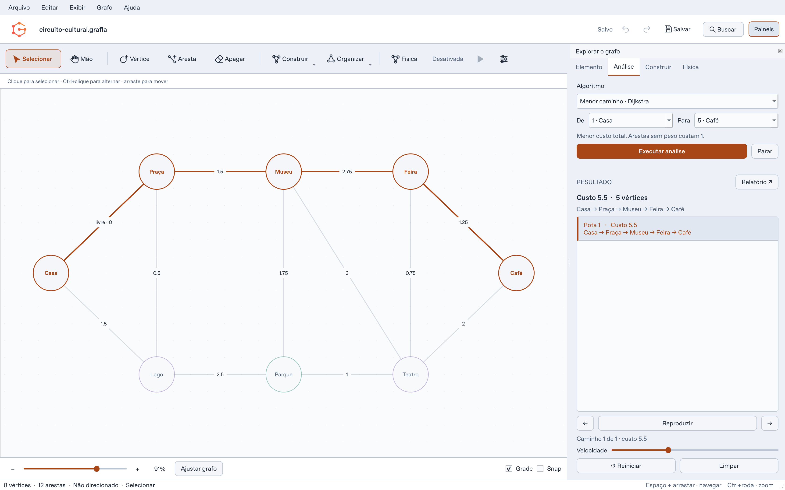

## Reproduzir as capturas

Os arquivos `.grafla` ficam em [`examples/galeria/`](../examples/galeria/). Abra pelo menu Arquivo ou passe o caminho ao iniciar:

```bash
uv run grafla examples/galeria/rotas-de-entrega.grafla
```

Para gerar as capturas novamente:

```bash
QT_QPA_PLATFORM=offscreen QT_SCALE_FACTOR=2 uv run python tools/capturar_galeria.py
```

A geração usa preferências temporárias e não altera os dados pessoais do editor.

Para gerar o GIF da física, tenha o FFmpeg instalado e execute:

```bash
QT_QPA_PLATFORM=offscreen QT_SCALE_FACTOR=1 uv run python tools/animar_fisica.py
```

O roteiro usa o controlador do aplicativo em passos de 30 ms e captura a interface
do Qt a 20 quadros por segundo. A câmera fica parada durante toda a animação.
