# Grafla em uso

Rotas, redes, buscas, matrizes e edição: 18 capturas do aplicativo em funcionamento. Os grafos são exemplos fictícios, feitos para explorar as ferramentas.

As imagens foram capturadas no Qt em Linux offscreen, com uma janela de 1600×1000 e escala de 150%. A captura dos ajustes avançados usa uma janela mais alta para mostrar o painel inteiro. A interface e os resultados são os do aplicativo, sem retoques. Clique em qualquer imagem para ver o tamanho completo.

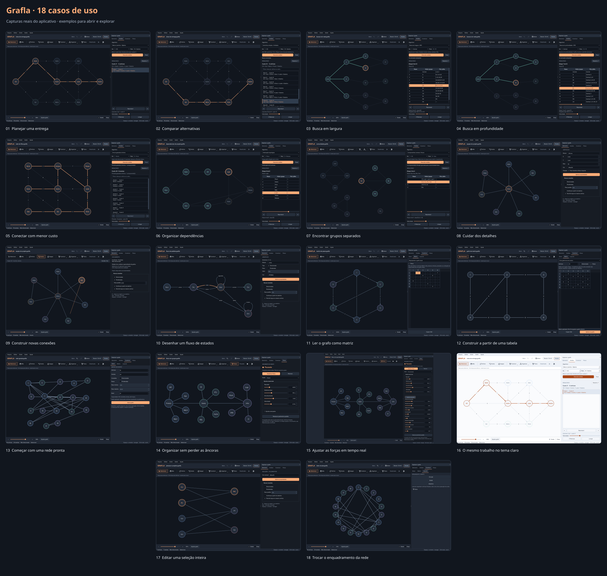

## Escolha um exemplo

| Captura | O que mostra |
| --- | --- |
| [01 · Planejar uma entrega](#caso-01) | Dijkstra encontra o menor custo entre o centro de distribuição e o destino. |
| [02 · Comparar alternativas](#caso-02) | A lista de rotas mostra custos e sequências; clicar em outra opção muda o destaque. |
| [03 · Busca em largura](#caso-03) | BFS percorre a rede por níveis. A tabela mostra a ordem das visitas e a fila. |
| [04 · Busca em profundidade](#caso-04) | A mesma rede percorrida em profundidade, com a pilha e o passo atual visíveis. |
| [05 · Conectar com menor custo](#caso-05) | Uma rede de fibra com nove pontos. A árvore mínima destaca as conexões escolhidas. |
| [06 · Organizar dependências](#caso-06) | Um projeto da primeira tarefa à publicação, com a ordenação topológica em etapas. |
| [07 · Encontrar grupos separados](#caso-07) | Quatro componentes, incluindo um vértice isolado. Um dos grupos está em destaque. |
| [08 · Cuidar dos detalhes](#caso-08) | Rótulo, posição, raio, cor e fixação do vértice central no inspector. |
| [09 · Construir novas conexões](#caso-09) | Origem marcada, prévia da aresta e novas conexões direcionadas, com peso e sequência. |
| [10 · Desenhar um fluxo de estados](#caso-10) | Um pedido pode aguardar, avançar, voltar ou falhar. Laços e arestas opostas coexistem. |
| [11 · Ler o grafo como matriz](#caso-11) | Arestas e pesos na tabela. O zero é uma conexão real; o ponto marca uma ausência. |
| [12 · Construir a partir de uma tabela](#caso-12) | A matriz vira um grafo editável, organizado para leitura. O peso zero também é preservado. |
| [13 · Começar com uma rede pronta](#caso-13) | O gerador criou 18 vértices e 24 arestas. A seed permite repetir o mesmo exemplo. |
| [14 · Organizar sem perder as âncoras](#caso-14) | Três centros fixados mantêm a estrutura; os demais vértices foram organizados pela física. |
| [15 · Ajustar as forças em tempo real](#caso-15) | Gravidade, direção, rigidez, centralização e limites de movimento nos ajustes avançados. |
| [16 · O mesmo trabalho no tema claro](#caso-16) | A rota de menor custo no tema claro, preservando os destaques e o contraste dos controles. |
| [17 · Editar uma seleção inteira](#caso-17) | Pessoas e projetos numa rede bipartida, com três elementos selecionados para edição em grupo. |
| [18 · Trocar o enquadramento da rede](#caso-18) | A rede do gerador reorganizada em círculo pelo painel de layouts, sem mudar as conexões. |

## Capturas

<a id="caso-01"></a>

### 01 · Planejar uma entrega

Dijkstra encontra o menor custo entre o centro de distribuição e o destino.

[Abrir o grafo de exemplo](../examples/galeria/rotas-de-entrega.grafla) · [Ver a imagem completa](screenshots/galeria/01-rotas-de-entrega.png)


<a id="caso-02"></a>

### 02 · Comparar alternativas

A lista de rotas mostra custos e sequências; clicar em outra opção muda o destaque.

[Abrir o grafo de exemplo](../examples/galeria/rotas-de-entrega.grafla) · [Ver a imagem completa](screenshots/galeria/02-comparar-caminhos.png)

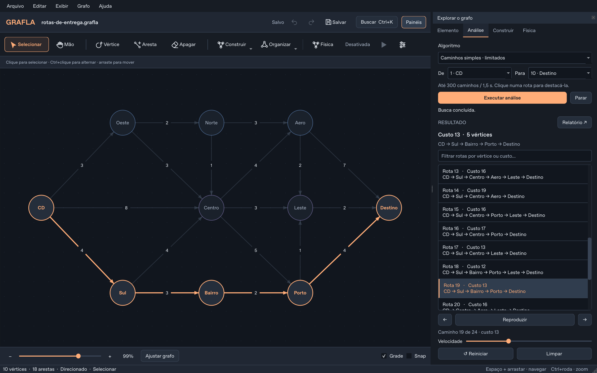

<a id="caso-03"></a>

### 03 · Busca em largura

BFS percorre a rede por níveis. A tabela mostra a ordem das visitas e a fila.

[Abrir o grafo de exemplo](../examples/galeria/buscas-em-rede.grafla) · [Ver a imagem completa](screenshots/galeria/03-busca-em-largura.png)

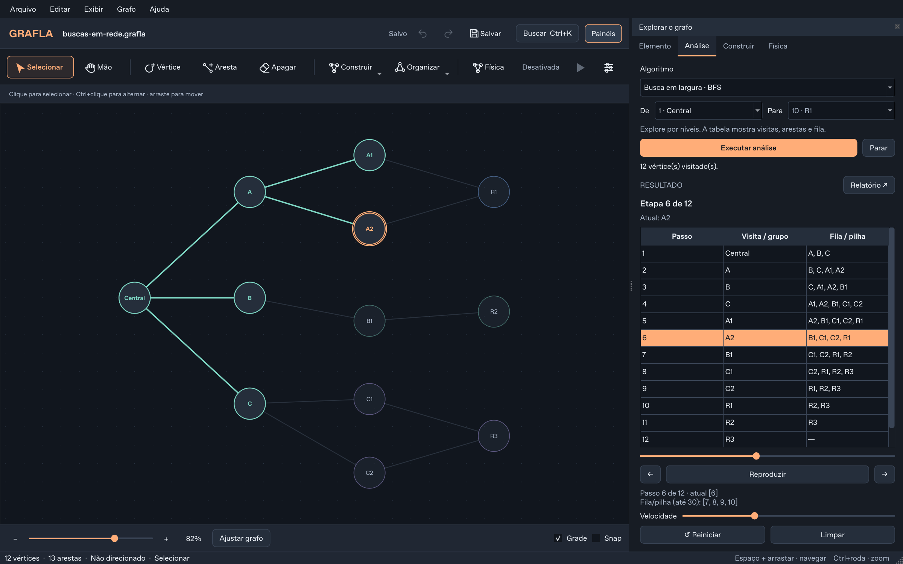

<a id="caso-04"></a>

### 04 · Busca em profundidade

A mesma rede percorrida em profundidade, com a pilha e o passo atual visíveis.

[Abrir o grafo de exemplo](../examples/galeria/buscas-em-rede.grafla) · [Ver a imagem completa](screenshots/galeria/04-busca-em-profundidade.png)

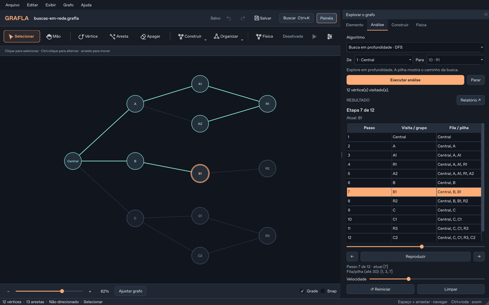

<a id="caso-05"></a>

### 05 · Conectar com menor custo

Uma rede de fibra com nove pontos. A árvore mínima destaca as conexões escolhidas.

[Abrir o grafo de exemplo](../examples/galeria/rede-de-fibra.grafla) · [Ver a imagem completa](screenshots/galeria/05-arvore-geradora-minima.png)


<a id="caso-06"></a>

### 06 · Organizar dependências

Um projeto da primeira tarefa à publicação, com a ordenação topológica em etapas.

[Abrir o grafo de exemplo](../examples/galeria/dependencias-do-projeto.grafla) · [Ver a imagem completa](screenshots/galeria/06-dependencias.png)


<a id="caso-07"></a>

### 07 · Encontrar grupos separados

Quatro componentes, incluindo um vértice isolado. Um dos grupos está em destaque.

[Abrir o grafo de exemplo](../examples/galeria/comunidades.grafla) · [Ver a imagem completa](screenshots/galeria/07-componentes.png)

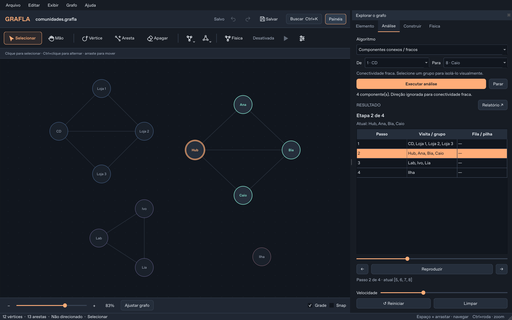

<a id="caso-08"></a>

### 08 · Cuidar dos detalhes

Rótulo, posição, raio, cor e fixação do vértice central no inspector.

[Abrir o grafo de exemplo](../examples/galeria/equipe-do-projeto.grafla) · [Ver a imagem completa](screenshots/galeria/08-propriedades.png)

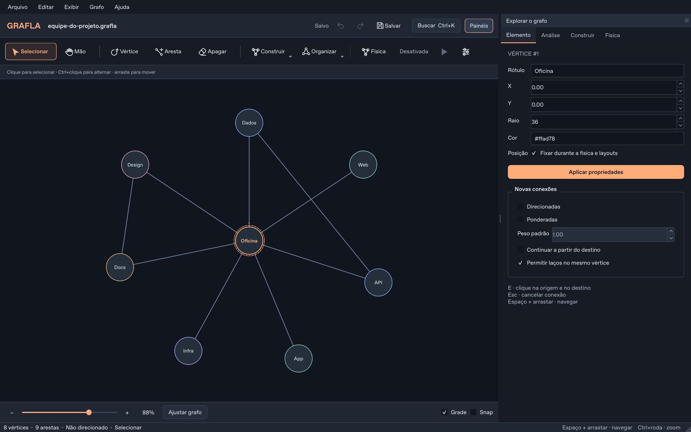

<a id="caso-09"></a>

### 09 · Construir novas conexões

Origem marcada, prévia da aresta e novas conexões direcionadas, com peso e sequência.

[Abrir o grafo de exemplo](../examples/galeria/equipe-do-projeto.grafla) · [Ver a imagem completa](screenshots/galeria/09-criar-conexoes.png)

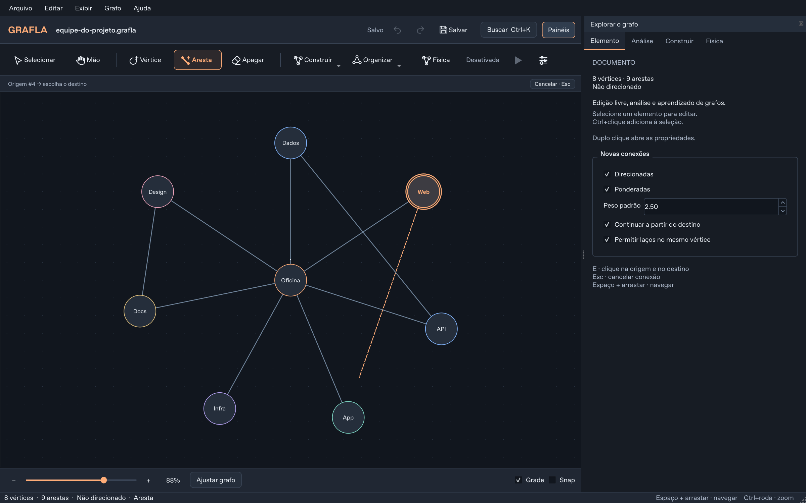

<a id="caso-10"></a>

### 10 · Desenhar um fluxo de estados

Um pedido pode aguardar, avançar, voltar ou falhar. Laços e arestas opostas coexistem.

[Abrir o grafo de exemplo](../examples/galeria/fluxo-de-pedidos.grafla) · [Ver a imagem completa](screenshots/galeria/10-lacos-e-opostas.png)

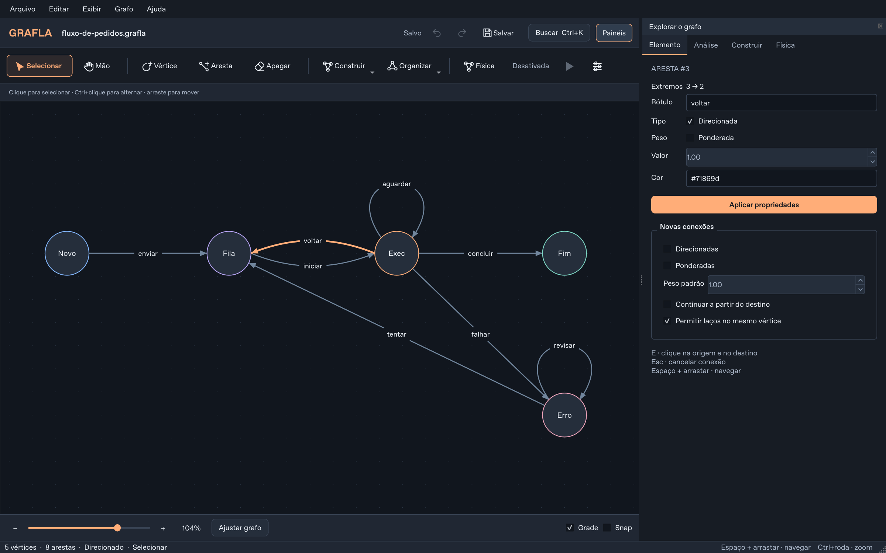

<a id="caso-11"></a>

### 11 · Ler o grafo como matriz

Arestas e pesos na tabela. O zero é uma conexão real; o ponto marca uma ausência.

[Abrir o grafo de exemplo](../examples/galeria/matriz-de-pesos.grafla) · [Ver a imagem completa](screenshots/galeria/11-grafo-para-matriz.png)

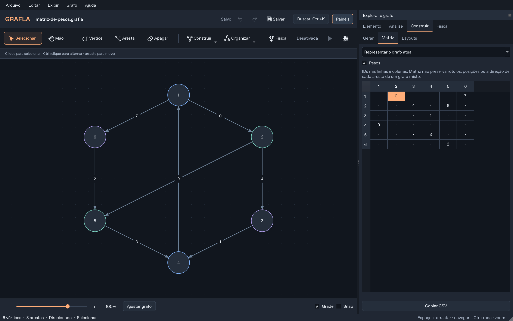

<a id="caso-12"></a>

### 12 · Construir a partir de uma tabela

A matriz vira um grafo editável, organizado para leitura. O peso zero também é preservado.

[Abrir o grafo de exemplo](../examples/galeria/grafo-da-matriz.grafla) · [Ver a imagem completa](screenshots/galeria/12-matriz-para-grafo.png)


<a id="caso-13"></a>

### 13 · Começar com uma rede pronta

O gerador criou 18 vértices e 24 arestas. A seed permite repetir o mesmo exemplo.

[Abrir o grafo de exemplo](../examples/galeria/rede-gerada.grafla) · [Ver a imagem completa](screenshots/galeria/13-gerador.png)

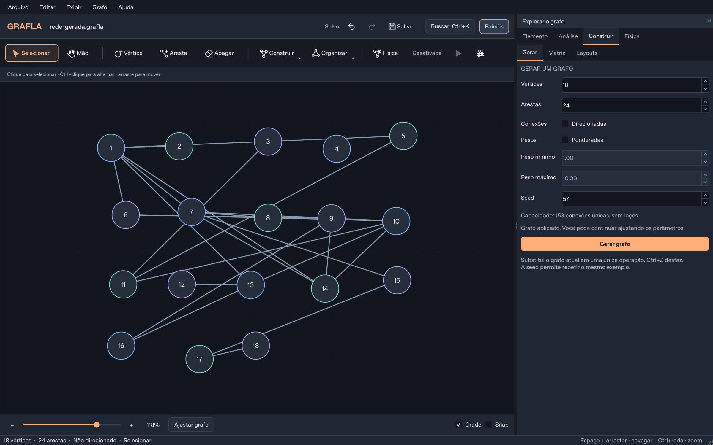

<a id="caso-14"></a>

### 14 · Organizar sem perder as âncoras

Três centros fixados mantêm a estrutura; os demais vértices foram organizados pela física.

[Abrir o grafo de exemplo](../examples/galeria/fisica-em-grupos.grafla) · [Ver a imagem completa](screenshots/galeria/14-fisica.png)

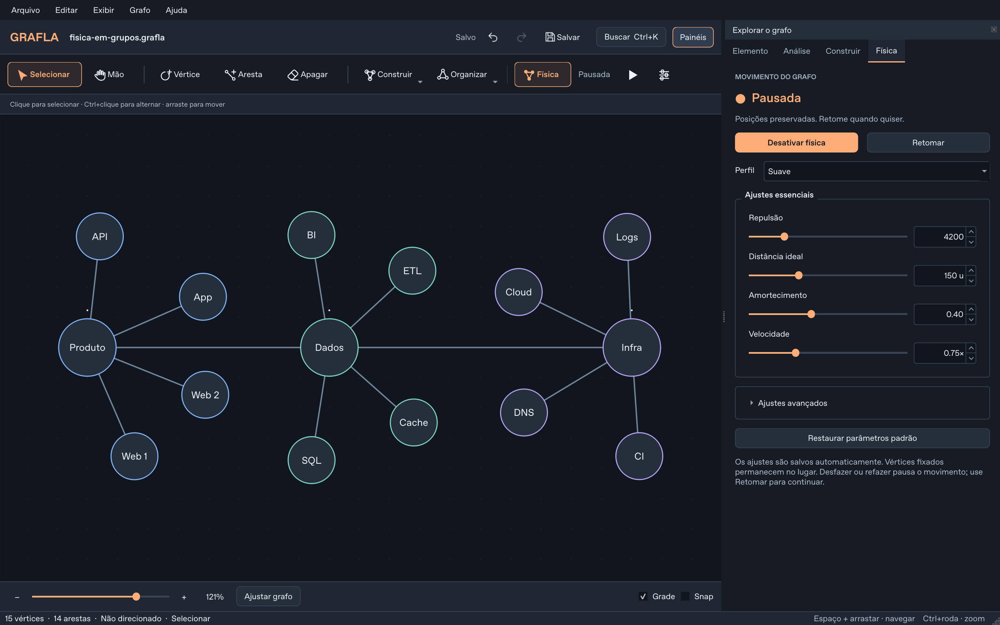

<a id="caso-15"></a>

### 15 · Ajustar as forças em tempo real

Gravidade, direção, rigidez, centralização e limites de movimento nos ajustes avançados.

[Abrir o grafo de exemplo](../examples/galeria/fisica-com-gravidade.grafla) · [Ver a imagem completa](screenshots/galeria/15-fisica-avancada.png)


<a id="caso-16"></a>

### 16 · O mesmo trabalho no tema claro

A rota de menor custo no tema claro, preservando os destaques e o contraste dos controles.

[Abrir o grafo de exemplo](../examples/galeria/rotas-de-entrega.grafla) · [Ver a imagem completa](screenshots/galeria/16-tema-claro.png)

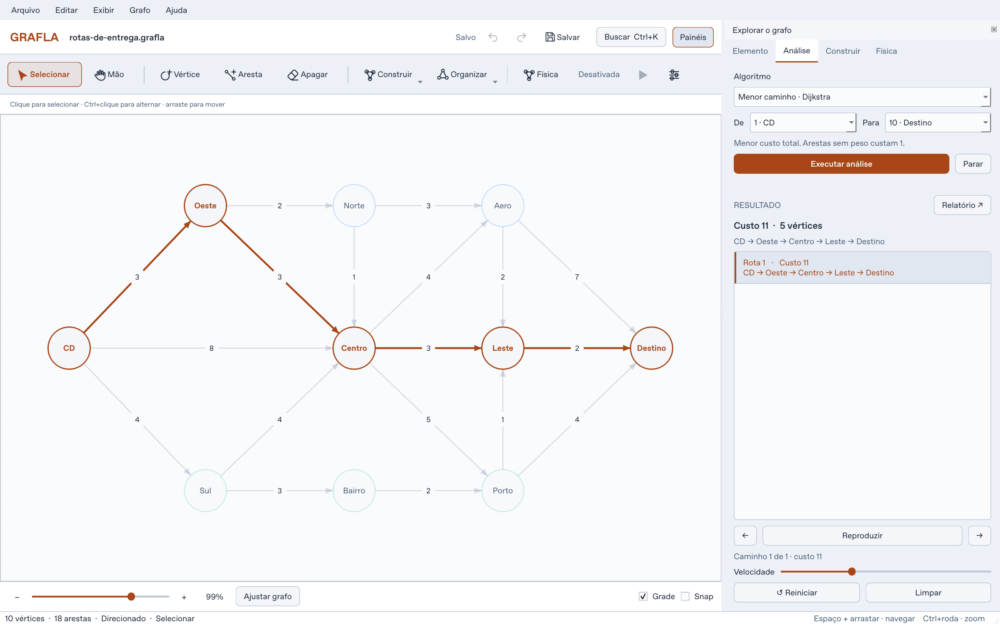

<a id="caso-17"></a>

### 17 · Editar uma seleção inteira

Pessoas e projetos numa rede bipartida, com três elementos selecionados para edição em grupo.

[Abrir o grafo de exemplo](../examples/galeria/pessoas-e-projetos.grafla) · [Ver a imagem completa](screenshots/galeria/17-selecao-em-grupo.png)

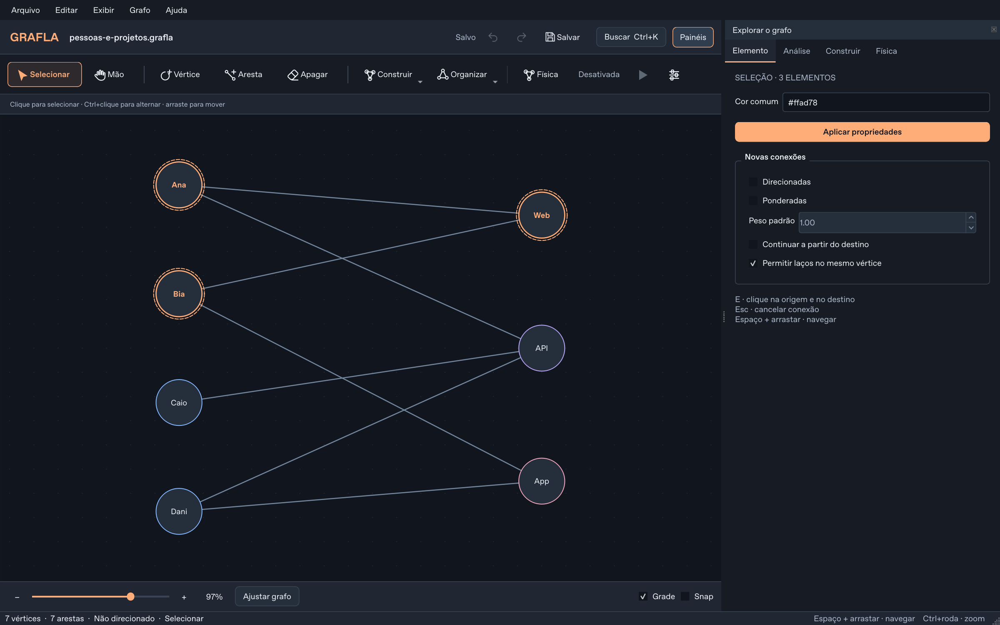

<a id="caso-18"></a>

### 18 · Trocar o enquadramento da rede

A rede do gerador reorganizada em círculo pelo painel de layouts, sem mudar as conexões.

[Abrir o grafo de exemplo](../examples/galeria/rede-circular.grafla) · [Ver a imagem completa](screenshots/galeria/18-layout-circular.png)

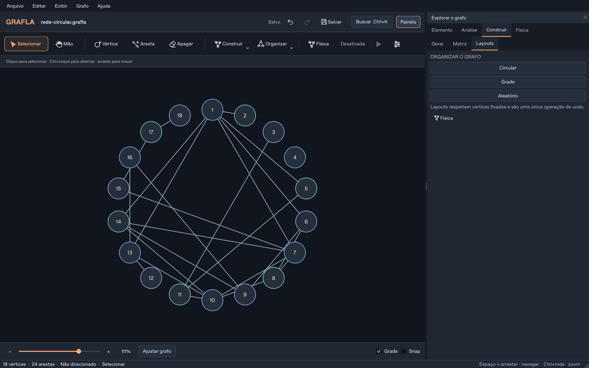

## Reproduzir as capturas

Os arquivos `.grafla` ficam em [`examples/galeria/`](../examples/galeria/). Abra pelo menu Arquivo ou passe o caminho ao iniciar:

```bash
uv run grafla examples/galeria/rotas-de-entrega.grafla
```

Para gerar as capturas novamente:

```bash
QT_QPA_PLATFORM=offscreen QT_SCALE_FACTOR=1.5 uv run python tools/capturar_galeria.py
```

A geração usa preferências temporárias e não altera os dados pessoais do editor.
